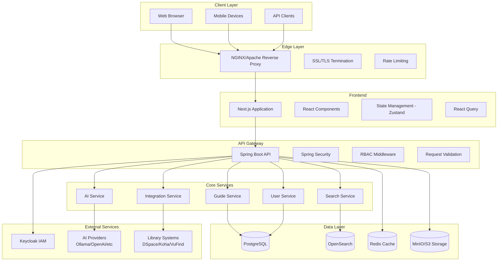
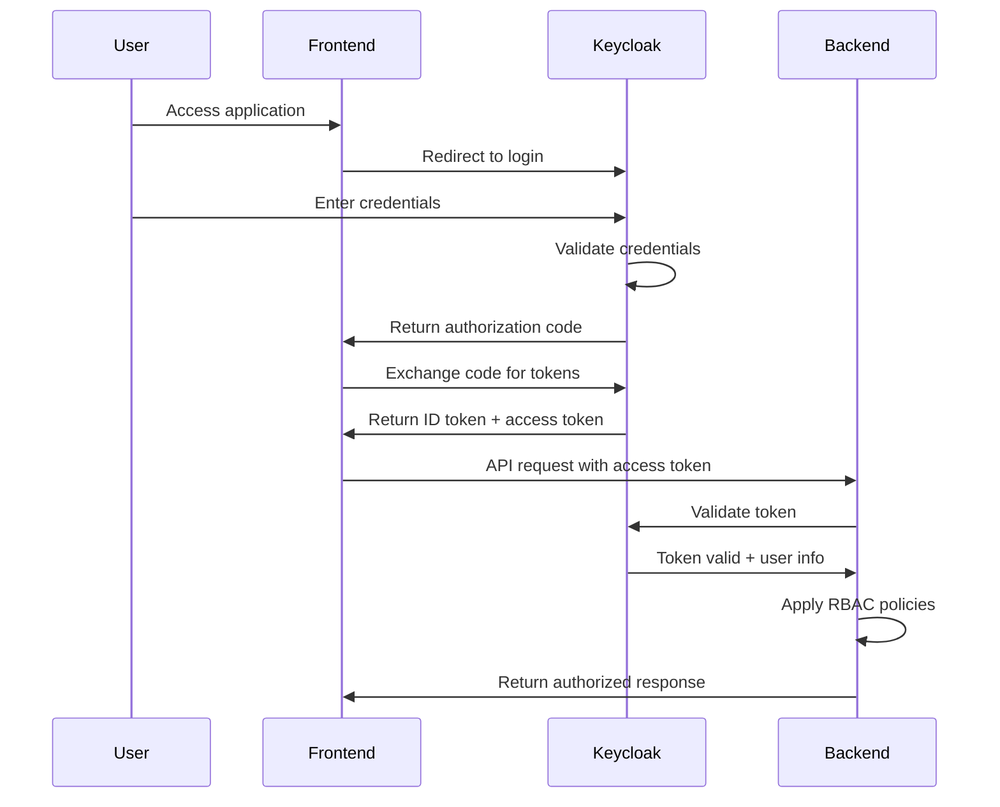
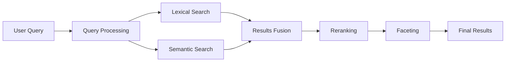
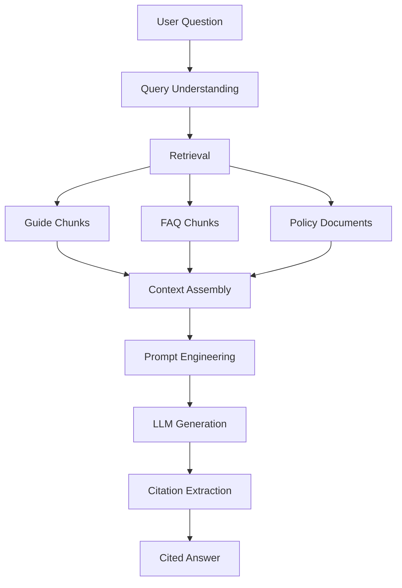
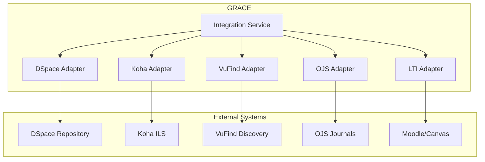

# GRACE Architecture Documentation

## System Architecture Overview

This document describes the architecture of the GRACE platform, following Clean Architecture and Domain-Driven Design principles.



## Layered Architecture

### 1. Presentation Layer (Frontend)

**Technology Stack:**
- Next.js 14+ with App Router
- React 18+
- TypeScript
- Tailwind CSS
- Zustand (state management)
- TanStack Query (data fetching)
- React Hook Form (forms)

**Responsibilities:**
- User interface rendering
- Client-side routing
- Authentication flow
- State management
- API communication
- Accessibility compliance (WCAG 2.2 AA)

**Key Components:**
- Layout components
- Page components
- Feature components
- UI component library
- Authentication providers
- API client hooks

### 2. API Layer (Backend)

**Technology Stack:**
- Spring Boot 3.x
- Java 21
- Spring Security
- Spring Data JPA
- OpenAPI/Swagger

**Responsibilities:**
- RESTful API endpoints
- Authentication & Authorization
- Request validation
- Response formatting
- Error handling
- Rate limiting
- Audit logging

**API Structure:**
```
/api/v1/
├── /auth/*           # Authentication endpoints
├── /tenants/*        # Tenant management
├── /guides/*         # Guide CRUD operations
├── /pages/*          # Guide pages
├── /databases/*      # Electronic resources
├── /books/*          # Book catalog
├── /librarians/*     # Librarian directory
├── /faqs/*           # FAQ management
├── /search/*         # Unified search
├── /semantic/*       # Semantic search
├── /ai/*             # AI features
├── /analytics/*      # Analytics data
└── /integrations/*   # Library system integrations
```

### 3. Domain Layer (Core Business Logic)

**Domain Models:**
- Tenant
- User
- Role & Permission
- Guide & Page
- Subject Taxonomy
- Course
- Database (Electronic Resource)
- Book
- Reading List
- Librarian
- FAQ
- Feedback
- Notification

**Domain Services:**
- GuideLifecycleService
- EditorialWorkflowService
- SearchService
- AIService
- IntegrationService
- NotificationService
- AnalyticsService
- LinkCheckerService

### 4. Infrastructure Layer

**Database (PostgreSQL):**
- Relational data storage
- Multi-tenant isolation via tenant_id
- Full-text search capabilities
- JSONB for flexible content
- UUID primary keys
- Row-level security ready

**Search Engine (OpenSearch):**
- Full-text indexing
- Faceted search
- Relevance scoring
- Highlighting
- Aggregations
- Vector search (for semantic)

**Cache (Redis):**
- Session storage
- API response caching
- Rate limiting counters
- Real-time notifications
- Background job queues

**Object Storage (MinIO/S3):**
- File uploads
- Image storage
- Document storage
- Backup archives

**Identity Provider (Keycloak):**
- User authentication
- OAuth2/OIDC provider
- SAML support
- LDAP/AD integration
- Role management
- Session management

## Multi-Tenancy Architecture

### Tenant Isolation Strategy

GRACE uses **logical isolation** with `tenant_id` on all tables:

```sql
-- Every table includes tenant_id
CREATE TABLE guides (
    id UUID PRIMARY KEY,
    tenant_id UUID NOT NULL REFERENCES tenants(id),
    -- other columns...
    UNIQUE(tenant_id, slug)  -- Unique per tenant
);

-- Index for tenant filtering
CREATE INDEX idx_guides_tenant ON guides(tenant_id);
```

### Tenant Configuration

Each tenant has:
- Unique domain/subdomain
- Custom branding (logo, colors)
- Theme configuration
- Authentication settings
- AI configuration
- Feature flags
- User management
- Content ownership

### Tenant Resolution

Tenants are resolved via:
1. **Domain-based**: `library.ucu.ac Uganda Christian University`
2. **Subdomain-based**: `ucu.grace.platform.org`
3. **Header-based**: `X-Tenant-ID` header
4. **Path-based**: `/tenants/ucu/guides`

## Security Architecture

### Authentication Flow



### RBAC Model

**Roles:**
- SUPER_ADMIN (system-wide)
- TENANT_ADMIN (institution-level)
- LIBRARY_ADMIN (library-level)
- GUIDE_ADMIN (guide management)
- LIBRARIAN (content creator)
- REVIEWER (approval workflow)
- CONTRIBUTOR (draft creation)
- FACULTY (elevated student)
- STUDENT (standard user)
- PUBLIC (unauthenticated)

**Permissions:**
- Resource-based: `guide`, `database`, `book`, `faq`, `user`, `role`, `tenant`, `ai`, `analytics`
- Actions: `create`, `read`, `update`, `delete`, `publish`, `review`, `approve`, `manage`, `configure`

### Security Controls

1. **Input Validation**: All inputs validated using Bean Validation
2. **SQL Injection Prevention**: Parameterized queries via JPA
3. **XSS Prevention**: Output encoding, CSP headers
4. **CSRF Protection**: Token-based CSRF protection
5. **Rate Limiting**: Per-user and per-IP rate limits
6. **Audit Logging**: All sensitive operations logged
7. **Secure Headers**: HSTS, CSP, X-Frame-Options, etc.
8. **Encryption**: TLS in transit, encryption at rest

## Search Architecture

### Hybrid Search Strategy

GRACE implements hybrid search combining:

1. **Lexical Search** (OpenSearch)
   - BM25 scoring
   - Full-text indexing
   - Faceted navigation
   - Phrase matching

2. **Semantic Search** (Vector Embeddings)
   - Document embeddings
   - Query expansion
   - Similarity matching
   - Cross-lingual support

### Search Pipeline



### Indexed Content Types

- Guides (title, content, metadata)
- Pages (content blocks)
- Databases (title, description, subjects)
- Books (title, authors, subjects)
- FAQs (question, answer)
- Librarians (name, expertise)
- Subjects (labels, definitions)
- Courses (code, title, description)

## AI Architecture

### AI Gateway Pattern

```java
public interface AIProvider {
    CompletableFuture<AIResponse> complete(AIRequest request);
    CompletableFuture<Embedding> embed(String text);
    boolean isAvailable();
}

// Implementations
public class OllamaProvider implements AIProvider { }
public class OpenAIProvider implements AIProvider { }
public class LlamaCppProvider implements AIProvider { }
public class LocalAIProvider implements AIProvider { }
```

### RAG Pipeline



### AI Governance

- **Provider Configuration**: Per-tenant AI provider selection
- **Token Quotas**: Daily/monthly limits
- **Privacy Controls**: PII redaction, privacy mode
- **Prompt Templates**: Configurable templates
- **Logging**: Optional prompt/response logging
- **Human Oversight**: Librarian review of AI responses

## Integration Architecture

### Library System Integrations



### Integration Patterns

1. **REST API**: Modern systems with REST interfaces
2. **OAI-PMH**: Repository harvesting
3. **SRU/Z39.50**: Legacy library protocols
4. **LTI 1.3**: LMS integration
5. **Webhooks**: Event-driven updates

## Deployment Architecture

### Docker Compose (Development/Small Scale)

Services:
- PostgreSQL
- Redis
- OpenSearch
- MinIO
- Keycloak
- Backend (Spring Boot)
- Frontend (Next.js)

### Kubernetes (Production)

- Horizontal Pod Autoscaling
- Persistent Volumes
- Ingress Controller
- Network Policies
- Secrets Management
- ConfigMaps
- Health Checks
- Rolling Updates

### High Availability

- Multiple backend replicas
- Database replication (PostgreSQL streaming)
- Redis Sentinel or Cluster
- OpenSearch cluster (3+ nodes)
- Load balancing
- Geographic distribution ready

## Monitoring & Observability

### Metrics (Prometheus)

- JVM metrics
- HTTP request metrics
- Database connection pool
- Cache hit rates
- Search query latency
- AI request counts
- Business metrics (guide views, searches)

### Logging (Structured JSON)

- Application logs
- Access logs
- Audit logs
- Error logs
- Performance logs

### Tracing (OpenTelemetry)

- Distributed tracing
- Span context propagation
- Performance profiling
- Dependency mapping

### Dashboards (Grafana)

- System health
- Application performance
- Business analytics
- Security monitoring

## Scalability Considerations

### Horizontal Scaling

- Stateless backend services
- Shared-nothing architecture
- Sticky sessions not required
- Easy container orchestration

### Caching Strategy

1. **L1 Cache**: Application-level (Caffeine)
2. **L2 Cache**: Distributed (Redis)
3. **CDN**: Static assets
4. **Browser**: HTTP caching headers

### Database Optimization

- Connection pooling (HikariCP)
- Read replicas for reporting
- Partitioning for large tables
- Index optimization
- Query plan analysis

### Search Optimization

- Index sharding
- Replica shards for reads
- Refresh interval tuning
- Bulk indexing
- Circuit breakers

## Extension Points

### Plugin Architecture

Future plugin system will support:

1. **Integration Plugins**: New library systems
2. **AI Plugins**: New AI providers
3. **Analytics Plugins**: Custom analytics
4. **Theme Plugins**: Custom themes
5. **Block Plugins**: New content blocks

### Webhook System

External systems can subscribe to events:

- Guide published
- Database updated
- User created
- Feedback submitted
- Broken link detected

### API Versioning

- URL versioning: `/api/v1/`, `/api/v2/`
- Backward compatibility maintained
- Deprecation policy documented
- Migration guides provided

## Compliance & Standards

### Accessibility

- WCAG 2.2 AA compliance
- Keyboard navigation
- Screen reader support
- Color contrast requirements
- Alt text enforcement
- Caption support
- Reduced motion option

### Internationalisation

- i18n framework ready
- RTL language support
- Locale-specific formatting
- Translation management
- Unicode support

### Metadata Standards

- Dublin Core
- Schema.org
- SKOS (taxonomy)
- FOAF (people)
- JSON-LD (linked data)
- MARC21 readiness

### Privacy Regulations

- GDPR compliance ready
- Data minimization
- Right to erasure
- Data portability
- Consent management
- Privacy by design

---

*This architecture document is living documentation and will evolve with the platform.*
